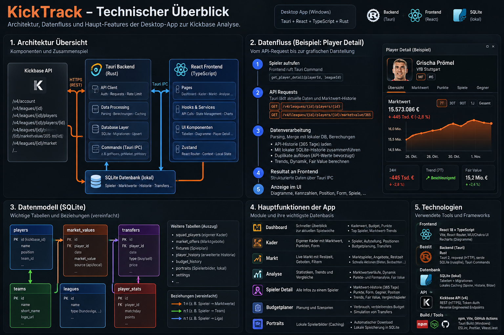

# KickTrack 0.8.31

Desktop-App für Kickbase auf Basis von Tauri, React und TypeScript. Das Rust-Backend kapselt Kickbase-Zugriffe, lokale Persistenz und autoritative Write-Preflights; das React-Frontend stellt Markt, Kader, Liga, Analysen und Player Detail dar.

## Technischer Überblick

<p align="center">
  
</p>

Die Grafik zeigt den vereinfachten Datenfluss von der Kickbase API über das Tauri-/Rust-Backend und die lokale SQLite-Persistenz bis zum React-/TypeScript-Frontend. Zusätzlich fasst sie zentrale Tabellen, Feature-Bereiche und den eingesetzten Stack zusammen.

## Aktueller Stand

- Transfermarkt mit Geboten, Verkäufen, Restzeit, Marktwert-/Punktesignalen und Budgetplaner.
- Kader- und Ligaansichten inklusive nächstem Spieltag und Managerdetails.
- Player Detail mit Marktwertverlauf, Punktehistorie, Fair Value, Restprogramm und Punkte-Aufschlüsselung.
- Markt- und Kadertabellen mit direkt sichtbarem MW-Verlauf und aktueller Spieltagsform.
- Lokale SQLite-Persistenz für historische Daten, Transfers, Portraits und Analytics.
- Gebote werden doppelt geprüft: lokaler Frontend-Preflight für Feedback und autoritativer Rust-Preflight direkt vor dem Kickbase-Write.
- Optionaler Dauerlogin: Nach ausdrücklicher Aktivierung liegen Zugangsdaten ausschließlich im Windows Credential Manager; KickTrack erneuert ablaufende Kickbase-Tokens vor der nächsten Anfrage.

Beim normalen Login wird kein Passwort gespeichert. „Dauerhaft angemeldet bleiben“ ist standardmäßig deaktiviert und kann jederzeit durch Abmelden widerrufen werden. Weil Kickbase keine dokumentierte Refresh-Token-Schnittstelle bereitstellt, erfolgt die Erneuerung über eine neue Anmeldung mit den geschützten Zugangsdaten. Schreibende Requests werden dabei nie automatisch wiederholt.

## Entwicklungssetup

Voraussetzungen: Node.js/npm sowie eine funktionierende Rust-/Tauri-Toolchain.

```bash
npm ci
npm run tauri dev
```

Relevante Checks:

```bash
npm test
npm run typecheck
npm run build
cargo clippy --manifest-path src-tauri/Cargo.toml --all-targets -- -D warnings
cargo test --manifest-path src-tauri/Cargo.toml
```

`npm test` verwendet den eingebauten Node-Test-Runner und benötigt keine zusätzliche Test-Library.

## Architektur

- `src/features/*`: fachlich geschnittene React-Features.
- `src/components/*`: wiederverwendbare UI-Komponenten.
- `src/lib/*`: kleine, projektweite Hilfen und fachliche Defaults.
- `src-tauri/src/commands/*`: Tauri-Commands und Write-Preflights.
- `src-tauri/src/kickbase/*`: Kickbase-HTTP-/Parsing-Schicht.
- `src-tauri/src/db/*`: SQLite-Schema, Migrationen und Persistenz.

Beim Start werden versionierte, idempotente Migrationen ausgeführt. Sie legen auch auf einer vollständig neuen Installation alle Tabellen für Marktwert-Historie und Dashboard-Snapshots an; bestehende AppData-Daten werden nicht zurückgesetzt.

Kickbase-spezifische Defaultregeln wie Kaderlimit und Kreditquote sind pro Runtime zentral definiert. API-Werte haben Vorrang; Defaults greifen nur, wenn Kickbase keinen Wert liefert.

## Changelog

### 0.8.31

- Dauerlogin mit proaktiver Token-Erneuerung über den Windows Credential Manager; sichere Opt-in-Voreinstellung und vollständiges Entfernen beim Logout.
- Markt-Formdaten werden gebündelt und begrenzt parallel geladen statt mit einer Anfrage pro Tabellenzeile.
- Fehlende Tabellen für frische SQLite-Installationen ergänzt und tägliche Kickbase-Historien ohne vorheriges Löschen gespeichert.
- Einheitliche `Europe/Berlin`-Semantik für Datumsgrenzen, validierte API-IDs, restriktive CSP und reduzierte Tauri-Berechtigungen.
- Lazy Loading für große Seiten, doppelte Provider entfernt sowie Typecheck-, Test-, Build- und CI-Kommandos ergänzt.
- Player Detail lädt die Marktwert-Historie primär über Kickbases 365-Tage-Endpunkt und schneidet die bestehenden 7T/30T/90T/1J-Ansichten weiterhin lokal.
- Lokale SQLite-Historie bleibt als Fallback erhalten und wird mit der Kickbase-Historie nach Datum zusammengeführt; Kickbase gewinnt bei überlappenden Tagen.
- Lücken in älteren lokalen Marktwert-Snapshots führen dadurch nicht mehr zu leeren kurzen Zeiträumen; ältere lokale Daten außerhalb des 365-Tage-Fensters bleiben für „Gesamt“ erhalten.
- Parser- und Merge-Regressionstests für die Marktwert-Historie ergänzt.

### 0.8.30

- Datenbank-Persistenz entlang klarer Verantwortlichkeiten in `db/migrations.rs`, `db/portraits.rs` und `db/transfers.rs` aufgeteilt; `db/mod.rs` bleibt der schlanke Einstieg für gemeinsame Stammdaten und Refresh-Snapshots.
- Debug-Ausgaben im Rust-Backend über ein gemeinsames Debug-Makro geführt; Debug-Logs werden nur in Debug-Builds ausgegeben.
- Frontend-Debug-/Warn-Ausgaben über `src/lib/logging.ts` vereinheitlicht und auf Development-Builds begrenzt.
- Keine neue Logging- oder Architektur-Dependency eingeführt; bestehende Contracts und Persistenzlogik bleiben unverändert.

### 0.8.28

- Player Detail: verbliebene `any`-Props und Breakdown-Items präzise typisiert.
- Business-Regeln: Default-Kaderlimit und 33-%-Kreditquote im Frontend zentralisiert; Rust-Preflight verwendet benannte Konstanten statt Magic Numbers.
- Repository-Hygiene: lokale `KickTrack-*.zip`-Artefakte werden ignoriert.
- README konsolidiert und veralteten Tauri-Template-/Duplikattext entfernt.

### 0.8.27

- Session-/Infrastrukturfehler werden nicht mehr als ausgeloggter Zustand verschluckt.
- Debug-Logging auf notwendige Metadaten reduziert.
- Kritische Gebots-/Budgetlogik mit Regressionstests abgesichert.

### 0.8.26

- Fair-Value-Referenz und Fixture Intelligence im Player Detail.
- Marktfilter für Hot, Effizient und eigene Gebote.
- Budget-Fallback bei fehlendem Kickbase-`pbaa`.

### 0.8.21–0.8.25

- Transfermarkt-Lesbarkeit, Punkte/Mio., nächster Gegner, Gebots-Sicherheitsprüfungen und Analysefunktionen schrittweise erweitert.

## Projektregeln

Änderungen sollen die bestehende Architektur erhalten, klein und überprüfbar bleiben und soweit möglich mit Tests, Typecheck/Build und Rust-Checks verifiziert werden. Keine Secrets oder rohe sensible API-Payloads committen oder loggen.
